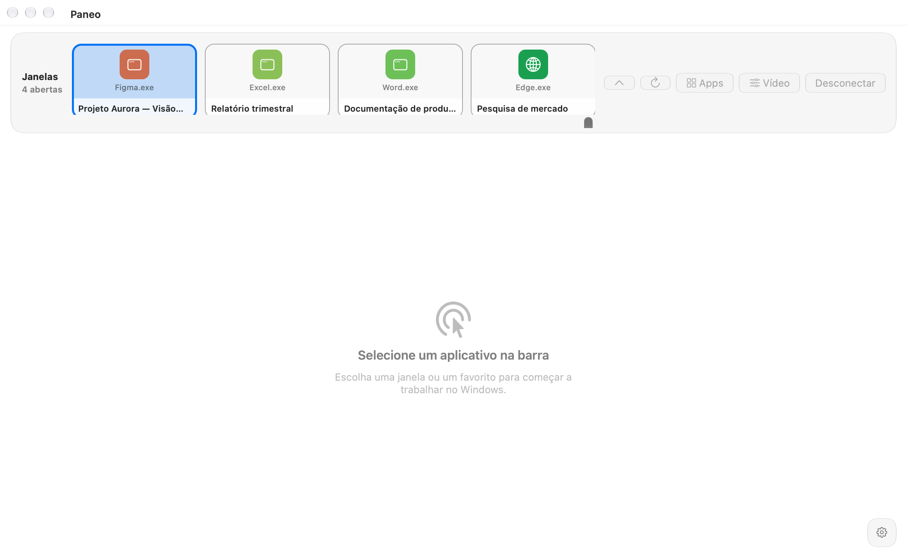
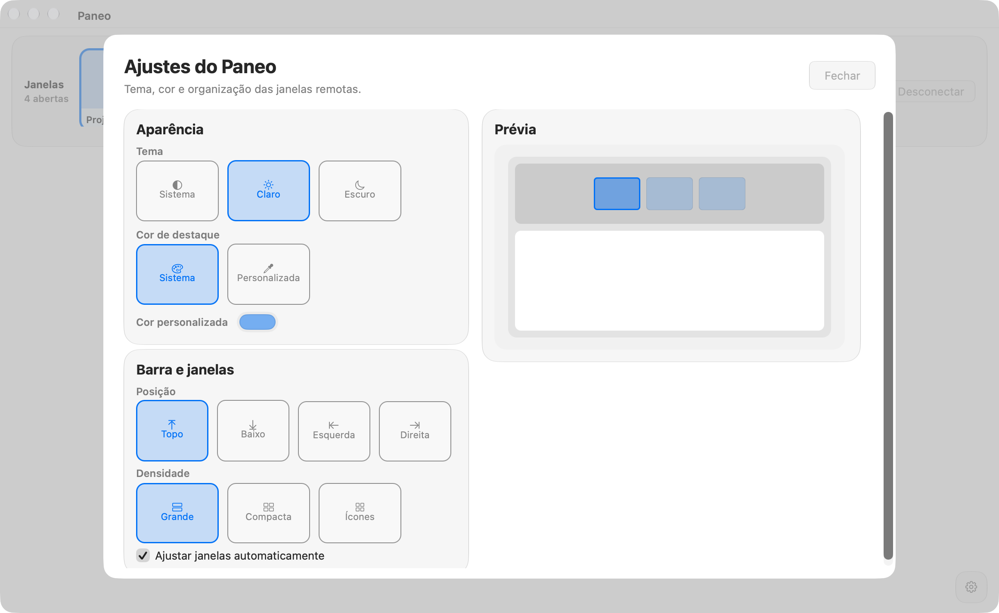
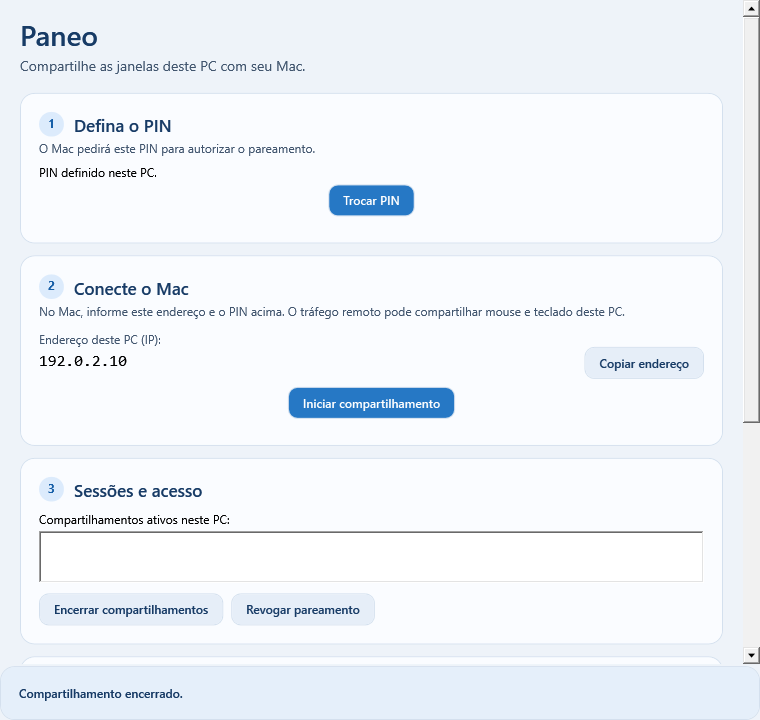

<p align="center">
  
</p>

<h1 align="center">Paneo</h1>

<p align="center">Your Windows apps, in windows on your Mac.</p>

<p align="center">
  <a href="README.md" lang="pt-BR">Português (Brasil)</a> · <strong>English (US)</strong>
</p>

<p align="center">
  
  
  
  
</p>

Paneo connects a Windows PC to a native macOS client. Choose a window to work
with on your Mac, switch between apps, or detach each app into its own window.
Your applications continue running on the PC.

**In development for personal use.** The current transport uses H.264 over
TLS/TCP, with PNG fallback. The 30 and 60 FPS options set the target frame rate;
actual performance depends on the application, hardware, and network.

## The apps

<p align="center">
  
</p>

<p align="center"><em>macOS client — window organization and session controls.</em></p>

| Mac customization | Windows sharing |
| --- | --- |
|  |  |

*Interface previews with demo data. The host address shown is fictitious;
these images do not represent a streaming benchmark. Interface labels are
currently shown in Portuguese.*

## What you can do

- **Choose your workspace:** stream a window or monitor, switch through the app
  bar, and open detached windows on your Mac.
- **Find applications:** discover PCs on your local network, search windows and
  apps published by the host with **⌘K**, and save favorites for each PC.
- **Control Windows:** use your mouse, hover, drag, scroll, enter Unicode text,
  and have common Command shortcuts mapped to Control.
- **Adjust readability:** automatically fit compatible windows to the video
  area and use the magnifier or **⌘+ / ⌘− / ⌘0** to change zoom. The host resizes
  the Windows window and restores its geometry when you leave or disconnect.
- **Customize the client:** choose light, dark, or system appearance, an accent
  color, any of four bar positions, and three densities. **⌘,** opens the settings popup.
- **Tune your session:** select quality, a resolution limit, and 30/60 FPS;
  recover from transient disconnections without replaying earlier input or commands.

The client uses AppKit and VideoToolbox. Its translucent appearance follows
macOS, with native Liquid Glass on macOS 26+ and a visual fallback on earlier versions.

## Get started

Use the Mac client and Windows host built from this repository.
Build instructions follow below; generated packages are development builds.
The UI labels below match the current Portuguese interface.

1. **On Windows**, open **Paneo Host** from its installed shortcut or run
   `WindowProbe.exe --host`. Set a PIN of 6–128 characters and click
   **Iniciar compartilhamento** (Start sharing). Note the displayed IP address
   and port (default `9443`).
2. **On your Mac**, open `Paneo.app`. Select the PC discovered on your local
   network or enter its IP address and port. Enter the PIN on your first
   connection and click **Conectar** (Connect).
3. **Choose a window** in the bar or use **Apps / ⌘K**. Subsequent connections
   use the saved pairing; you can revoke it at any time from the Windows host.

To start the host after login, save the PIN and enable
**Iniciar e compartilhar automaticamente ao entrar no Windows** (Start and share
automatically at Windows login). This applies to the current account;
closing the host stops sharing.

### Pairing and access

Pairing uses a PIN with PBKDF2-HMAC-SHA256 and an HMAC proof. Traffic uses TLS
with the host certificate pinned; persisted credentials are protected by
macOS Keychain and Windows DPAPI. The host applies progressive IP rate limiting
to authentication attempts. **Revogar pareamento** (Revoke pairing) stops sharing,
revokes all paired devices, and asks you to set a new PIN.

### Current limitations

- Paneo shares the existing Windows session. Mouse and focus are shared with
  anyone using the PC; it does not create an independent desktop.
- Windows must be powered on with an interactive user session signed in.
  Pre-login access, unlocking, UAC, and protected content are unsupported.
- Minimizing a window pauses its video; restoring it allows streaming to resume.
  Zoom and automatic fitting require resizable windows and respect their minimum
  sizes and the monitor's available work area.
- Standard Win32 menus can appear in Mac controls; custom menus rely on interaction
  through the video. Compatibility varies by application.
- Automatic discovery works on the local network. Direct internet connectivity
  without a VPN or router configuration is still pending.
- Broad compatibility, clean-machine installation, and sustained 60 FPS across
  all scenarios still need validation.

## Build from source

Run commands from the repository root on the indicated platform.

| Component | Build requirements | Compatibility |
| --- | --- | --- |
| macOS client | macOS 14+, Swift 6, and Xcode Command Line Tools | Builds for the local architecture; does not produce a Universal binary. |
| Windows host | .NET 10 SDK; Inno Setup 6.3+ for the installer | Declared target: Windows 10 build 19041+ x64. Validated on Windows 11 Pro; this does not establish support for all editions. |

### macOS

```sh
# Build the executable
swift build --package-path mac/RemoteDesktop -c release

# Generate Paneo.app and a DMG in packaging/mac/dist/
sh packaging/mac/build-mac.sh
```

Packaging requires a signing identity named `Paneo Development` in Keychain,
or another identity selected with `PANEO_CODESIGN_IDENTITY`.
For a local build with ad-hoc signing, explicitly select
`PANEO_CODESIGN_IDENTITY=- sh packaging/mac/build-mac.sh`.
The default configuration uses a local certificate, without Developer ID or
notarization; Keychain prompts may reappear after rebuilding.

### Windows

```powershell
# Build the host
dotnet build windows/WindowProbe/WindowProbe.csproj -c Release

# Generate the installer in packaging/windows/dist/ (requires Inno Setup)
powershell -ExecutionPolicy Bypass -File packaging/windows/build-installer.ps1
```

The installer is per-user, includes the .NET runtime, and is not code-signed.
It does not configure firewall rules automatically.

### Development checks

```sh
# .NET suites — run transport on Windows to cover native paths
dotnet run --project tests/TransportTests/TransportTests.csproj -c Release
dotnet run --project tests/AppCatalogTests/AppCatalogTests.csproj -c Release
dotnet run --project tests/VideoQualityChecks/VideoQualityChecks.csproj -c Release

# Interface and preferences — run on macOS
mac/RemoteDesktop/Scripts/test-customization.sh
mac/RemoteDesktop/Scripts/test-settings.sh
mac/RemoteDesktop/Scripts/test-stream-controls.sh
mac/RemoteDesktop/Scripts/test-zoom-slider.sh
```

These checks cover parts of the system; they do not replace a real session
between Windows and Mac or manual keyboard, network, and installation testing.

## Code and documentation

| Path | Contents |
| --- | --- |
| [`mac/RemoteDesktop`](mac/RemoteDesktop) | Swift/AppKit client and interface harnesses. |
| [`windows/WindowProbe`](windows/WindowProbe) | WPF/.NET host, Windows.Graphics.Capture, encoder, and remote input. |
| [`tests`](tests) | Transport, pairing, catalog, video, and host suites. |
| [`packaging`](packaging) | Mac bundle and Windows installer scripts. |

More details (in Portuguese): [macOS client](mac/RemoteDesktop/README.md) ·
[Windows capture and diagnostics](windows/WindowProbe/README.md).
