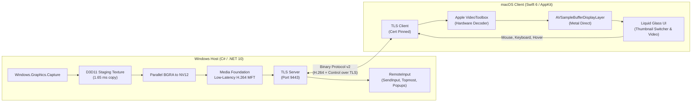

<p align="center">
  
</p>

# Paneo

[](https://github.com/wellingtonbarbosadev/paneo)
[](https://github.com/wellingtonbarbosadev/paneo)
[](https://github.com/wellingtonbarbosadev/paneo)
[](https://github.com/wellingtonbarbosadev/paneo)

> **Stream individual Windows applications directly into native macOS windows at 60 FPS.**<br/>
> Paneo brings the power of your Windows PC to your Mac with per-window capture, zero-knowledge pairing, and seamless Liquid Glass integration.

---

## Overview

Unlike traditional remote desktop solutions (RDP/VNC) that mirror the entire desktop and hijack your screen layout, **Paneo** captures and streams **individual Windows application windows** directly into macOS.

Each remote application behaves like a first-class citizen on your Mac: complete with fluid 60 FPS video, native hover and mouse interactions, live thumbnail app switching, and hardware-accelerated video decoding.



---

## Key Features

- 🪟 **Per-Window Streaming**: Run and view specific Windows apps (Discord, Notepad, browsers, IDEs, and heavy desktop tools) on macOS without streaming empty desktop background space.
- ⚡ **Rock-Solid 60 FPS Video Pipeline**:
  - Direct3D 11 Staging Textures (`CopyResource` + `Map`/`Unmap`) transfer GPU frames in **~1.65 ms**.
  - Optimized Media Foundation H.264 encoder operates in low-latency slice mode.
  - Apple VideoToolbox decodes access units directly into `AVSampleBufferDisplayLayer` with zero copy overhead.
- 🎨 **Unified Liquid Glass Interface**:
  - Native macOS AppKit design with translucent glass styling (`NSGlassEffectView` / `NSVisualEffectView`).
  - Top horizontal thumbnail bar showcasing **real-time live snapshots** of open applications and native Windows process icons.
  - Instant one-click window switching without tearing down the underlying session.
- 🔒 **Zero-Knowledge PIN Security**:
  - Effortless pairing via IP and a user-selected 6-digit PIN.
  - PBKDF2-HMAC-SHA256 (600,000 iterations) mutual authentication proof prevents plaintext or hash leakage.
  - Device tokens protected securely via macOS Keychain and Windows DPAPI.
  - Strict TLS transport with certificate pinning and progressive IP rate limiting against brute-force attempts.
- 🖱️ **Full Interactivity & Window Fidelity**:
  - **Fluid Hover Tracking**: Moves the host cursor cleanly and renders host cursor changes natively in the stream.
  - **Context Menus & Popups (`PopupComposer`)**: Automatically detects, captures, and composites Windows context menus and popup dialogs over the stream.
  - **Active Z-Order Guard**: Asserts `HWND_TOPMOST` during active interaction so other PC windows never obstruct your remote session, restoring original Z-order upon disconnection.
  - **Unicode & Keyboard Composition**: Full support for international accents (PT-BR), Ctrl/Cmd shortcuts, navigation keys, and text composition.
- 💡 **Smart Display Wake Lock**:
  - Native Windows energy locks (`ES_CONTINUOUS | DISPLAY`) wake and keep the display pipeline active, ensuring stable 60 FPS delivery even if the physical PC monitor is asleep.

---

## Quick Start

### 1. Windows Host Setup

1. Launch `WindowProbe.exe --host` on your Windows 11 PC.
2. The host UI opens and automatically engages the display lock.
3. Configure your 6-digit PIN (or use the generated PIN).
4. Note the displayed Local IP address (and default port `9443`).

### Start the Windows host automatically

After saving a PIN, enable **Iniciar e compartilhar automaticamente ao entrar no Windows**
in the host window. At the next login to that Windows account, the host starts
sharing with the saved PIN, port and hover preference, then minimizes to the taskbar.
Uncheck the option to disable it. Closing the host stops sharing.

For an installed executable, the equivalent commands are:

```powershell
.\WindowProbe.exe --host --enable-startup
.\WindowProbe.exe --host --disable-startup
```

Startup uses the current user's `Run` registry entry and does not require admin
rights. Enable it from a stable installation directory, since moving the executable
requires enabling it again. No Windows password is stored or automatic Windows login
configured. **Remote access before login, unlocking Windows and UAC secure desktop
control are not supported by the current host.**

### 2. macOS Client Setup

1. Open `Paneo.app` (or mount `packaging/mac/dist/Paneo-0.1.0-mac-arm64.dmg`).
2. Selecione um PC próximo ou informe o **IP** manualmente e o **PIN** do Windows.
3. Click **Connect**:
   - The device token is stored securely in your macOS Keychain.
   - Paneo immediately lists all active Windows applications on the top horizontal bar.
4. Click on any application thumbnail card to start interacting at 60 FPS!

### Customize your workspace

Open **Ajustes…** with the always-visible gear button, from the app menu, or press **⌘,**.
Settings open in the main window, with a **Back** button to return to your session.
The page includes visual choices and a live preview for the app bar's
position (top, bottom, left or right), density (large previews, compact cards or
icons), light/dark/system appearance, and accent color. The defaults are a top
bar with compact cards and the system appearance. Changes apply and save immediately on this Mac.

Short transitions accompany navigation, search, cards, and settings, respecting
the system's reduced-motion preference. Session metrics are available under
**Detalhes**; **Reconectar** appears when the stream needs recovery. The Windows
host follows the same Paneo visual language, with a guided PIN/sharing/session
layout, a copyable IP address, advanced options, and a status footer.

Right-click an app card to add it to **Favoritos**. Favorites are saved per PC
and can be reordered by dragging. Clicking a favorite opens its window, or offers
a window chooser when several are open. Closed favorites can launch apps supported
by the Windows host's existing launcher; other apps must first be opened on the PC.

---

## Developer Guide

### Prerequisites

- **macOS**: macOS 14.0+ (Apple Silicon recommended), Swift 6.0+ / Xcode Command Line Tools.
- **Windows**: Windows 11 Pro/Home (build 22000+), .NET 10 SDK, Visual Studio C++ build tools (optional).

### Building the macOS Client

```bash
# Build the release app bundle and DMG installer
./packaging/mac/build-mac.sh

# The signed app and DMG are generated in packaging/mac/dist:
# - packaging/mac/dist/Paneo.app
# - packaging/mac/dist/Paneo-0.1.0-mac-arm64.dmg
```

The packaging script signs both artifacts with the local **Paneo Development**
identity by default. To select another matching code-signing identity from the macOS Keychain,
set `PANEO_CODESIGN_IDENTITY="Identity Name"` before running it. Ad-hoc signing
is available only when explicitly selected with `PANEO_CODESIGN_IDENTITY=-`;
the script stops before SwiftPM or cleaning `dist` if the selected identity is
missing. This local certificate is for development on that Mac, not Developer
ID, notarization, or distribution. A stable certificate keeps the code
signature's designated requirement stable, but does **not** guarantee that
Keychain items will stop prompting: runtime checks found that macOS can assign
unsigned/self-signed developers a per-build `cdhash` Keychain partition even
when the designated requirement and certificate stay the same. Apple’s
[securityd client-identification](https://github.com/apple-oss-distributions/Security/blob/main/securityd/src/clientid.cpp)
and [partition ACL](https://github.com/apple-oss-distributions/Security/blob/main/securityd/src/acls.cpp)
sources describe this separate partition check. An Apple-issued Apple
Development identity associated with a team may provide a stable team
partition; a Personal Team may be available through Xcode depending on the
account, but this path has not been configured or tested here and does not
validate access to legacy items. Existing ad-hoc items may still ask for
authorization or require user-approved migration.

To run a fast development build via Swift CLI:
```bash
cd mac/RemoteDesktop
swift build -c release
```

### Building the Windows Host

```bash
# Using local .NET 10 SDK:
.tools/dotnet/dotnet build windows/WindowProbe/WindowProbe.csproj -c Release

# Or using system dotnet:
dotnet build windows/WindowProbe/WindowProbe.csproj -c Release
```

The resulting executable will be at `windows/WindowProbe/bin/Release/net10.0-windows10.0.19041.0/WindowProbe.exe`.

### Running Automated Test Suites

```bash
# Run unit & transport protocol tests (.NET)
dotnet run --project tests/TransportTests/TransportTests.csproj -c Release
dotnet run --project tests/AppCatalogTests/AppCatalogTests.csproj -c Release
dotnet run --project tests/VideoQualityChecks/VideoQualityChecks.csproj -c Release

# Layout, preferências e controles no Mac (sem credenciais reais)
mac/RemoteDesktop/Scripts/test-customization.sh
mac/RemoteDesktop/Scripts/test-stream-controls.sh

# Run Mac transport & reconnection fixtures
python3 scripts/test-mac-transport.py
python3 scripts/test-mac-reconnect.py
```

---

## Architecture & Protocol

Paneo operates over **Binary Protocol v2**:
- **Framing**: Big-endian length-prefixed binary frames (`[u32 length][u8 message_type][payload]`).
- **Media Stream**: H.264 Annex-B NAL units with a compact 16-byte header (`[type][codec][flags][seq][pts][width][height]`).
- **Control Path**: JSON control messages over the same TLS connection handling window lists (`windows`), view selection (`view`), mouse pointer events (`pointer`), keyboard events (`key`, `text`), and graceful input rejection notifications (`inputRejected`).

---

## License

This project is licensed under the MIT License. See [LICENSE](LICENSE) for details.
